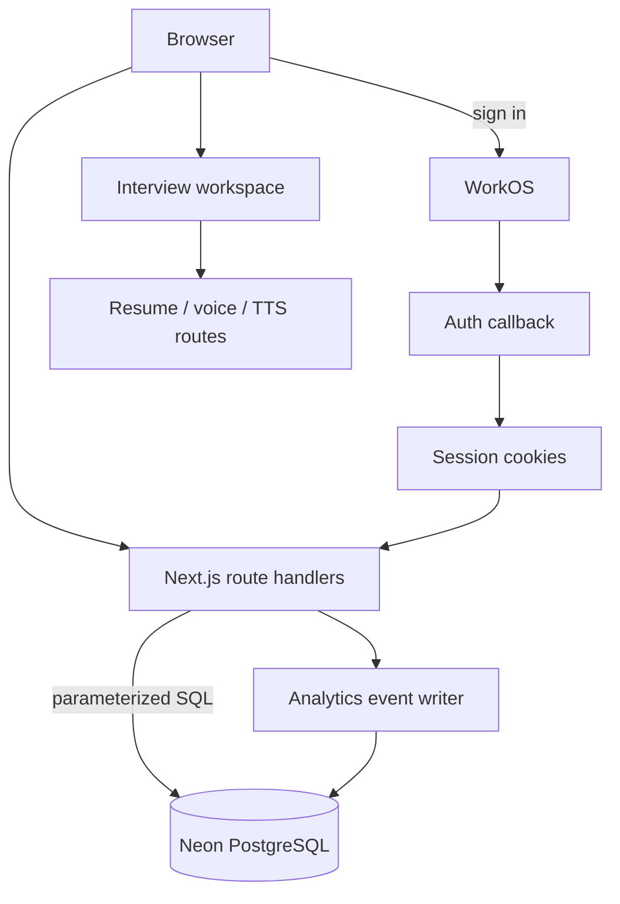

# Nextprod

An authenticated productivity workspace combining per-user task management, interview practice, and an internal analytics dashboard. A deployment is available at [nextprod-neon.vercel.app](https://nextprod-neon.vercel.app).

## Implemented features

- WorkOS sign-in and callback routes with server-side access checks.
- Task creation, listing, completion toggles, and deletion scoped to the authenticated email.
- PostgreSQL persistence through parameterized queries and a pool sized for serverless execution.
- Interview practice routes for resume parsing, voice/TTS, role selection, and answer feedback.
- Server-side product-event capture and an admin analytics view.

## Architecture



### Task data flow

1. A route reads the server-managed user cookie and rejects unauthenticated requests.
2. The API validates and normalizes task fields.
3. Parameterized SQL scopes each read or write by `user_email`.
4. Successful mutations record non-blocking analytics metadata.
5. The client refreshes its state from the API response.

## Technical decisions

- **Server-side identity boundary:** queries do not accept user identity from the request body.
- **Parameterized SQL:** values are bound separately from query text.
- **Small connection pool:** `max: 3` limits connections created by a serverless process.
- **Failure isolation:** analytics uses a safe wrapper so telemetry cannot break a successful product action.
- **Separated routes:** authentication, tasks, analytics, resume, and speech have independent handlers.

## Local setup

```bash
npm install
npm run dev
```

Create `.env.local` with PostgreSQL and WorkOS variables referenced by server files. Interview-provider variables are optional unless those routes are exercised. Do not commit secrets.

The database must contain the tables queried under `app/api/` and `lib/analytics.ts`. Schema migrations are not yet committed, so a fresh environment needs that schema before the full app can run.

## Verification

```bash
npm run build
```

## Limitations

- There is no committed migration or seed workflow.
- Cookie-backed identity should be consolidated into one documented session abstraction before production use.
- Provider-backed interview routes require external services.
- The repository has no automated test suite.
- Admin authorization depends on `lib/admin.ts` configuration and must be set deliberately.
