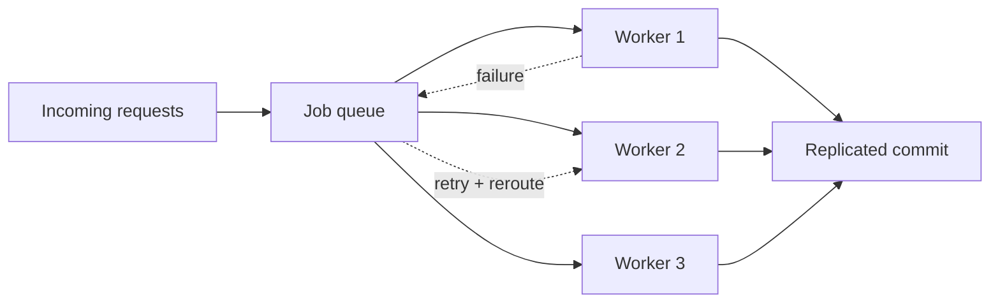

# Faultline

An interactive distributed-systems failure lab that runs entirely in the browser. Send a traffic burst, stop a worker, and watch queue pressure, retries, latency, health, and recovery change in real time.

## Why it exists

Concepts such as backpressure, replication, rerouting, and idempotent retries are often explained with static diagrams. Faultline turns them into a small system you can break and observe.

## What the simulation models



- A three-worker pool distributed across simulated regions.
- Queue growth and draining based on available throughput.
- Traffic bursts that trigger visible backpressure.
- Worker failure, rerouting, recovery, and replicated-state rejoin.
- Live availability, latency, completed-job, retry, CPU-load, and event displays.
- Pause, resume, overload, failure-injection, and reset controls.

This is an educational simulation, not a production benchmark or a connection to real infrastructure. The state machine is implemented in `app/page.tsx` and deliberately requires no account, API key, model, or backend service.

## Run locally

```bash
npm install
npm run dev
```

Then open `http://localhost:3000`.

## Verify

```bash
npm run build
```

## Stack

Next.js 15, React 19, TypeScript, CSS, and Lucide icons.

## Current limitations

- All cluster behavior is simulated in one browser tab.
- Timing and load values illustrate system relationships; they are not benchmark results.
- Refreshing the page resets the simulation.
- Legacy authenticated productivity and interview routes remain isolated from the new landing experience and are not part of the simulation.
